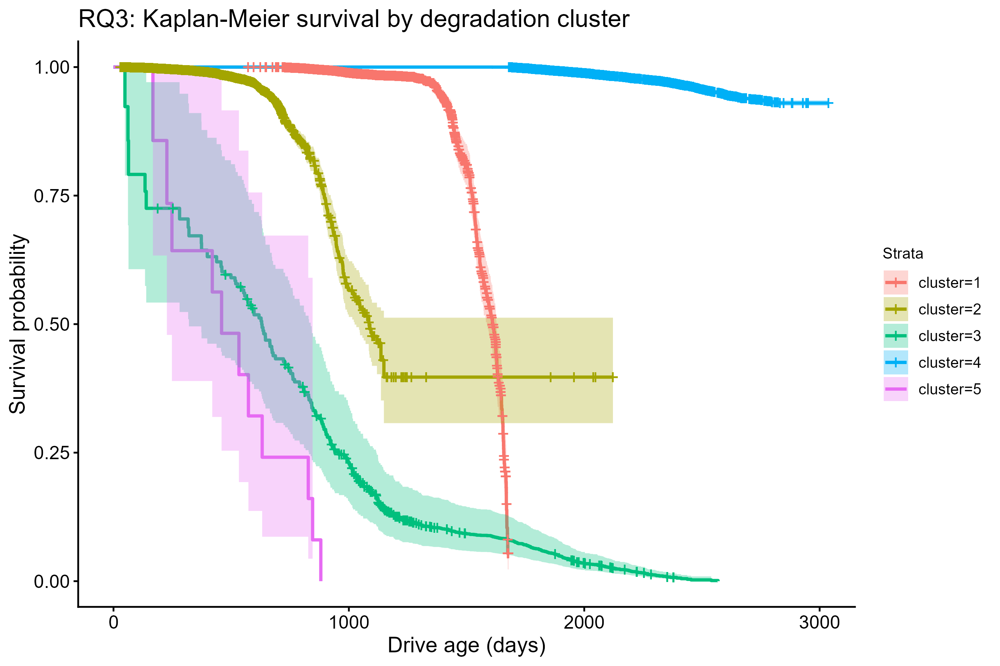

# Hard Drive Failure Risk Modelling

Predicting and segmenting hard drive failures from Backblaze SMART telemetry across ~197,000 drives and ~127 million drive-days. Clustering on degradation features, with no failure labels, found a group of drives with a 68.9% failure rate, against 1.1% in the largest group.

**[Read the full report](https://qw04.github.io/Warranty/)**



## Results

| Question | Method | Finding |
| --- | --- | --- |
| Can SMART readings predict failure within 30 days? | Logistic regression, elastic net | AUC 0.85 for logistic regression, ahead of elastic net at 0.79 |
| Do rolling time-series features help? | 7- and 30-day mean, slope, volatility | AUC unchanged (0.791 vs 0.790), PR-AUC up from 0.489 to 0.509 |
| Are there distinct degradation patterns? | K-means (k=5, chosen by silhouette score) | Failure rates from 1.1% to 68.9% across clusters of 500+ drives |
| Which drive models carry the most risk? | Kaplan-Meier, Cox proportional hazards | Hazard ratios up to ~8.6x the reference model |
| How does risk translate into expected cost? | Regression on Cox-based expected loss | R² = 0.81; most variation is between drive models, not coverage length |

**Tech:** Python (data pipeline, feature engineering), R (`survival`, `glmnet`, `cluster`, `pROC`), R Markdown

## What I'd do next

- Use real replacement prices instead of the $25/TB proxy
- Model time-varying effects, since the data rejects strict proportional hazards
- Extend the sample from 2021–2022 to the full 2016–2022 data

## Overview

This project applies classification, time-series feature engineering, clustering and regression to hard drive failure risk, with Kaplan-Meier and Cox survival analysis used to handle censoring and cross-check the results.

## Research Questions

- **RQ1 (Classification)** - Can early-life SMART attributes and recent SMART
  trends predict whether a drive will fail within the next 30 days?
- **RQ2 (Time series)** - Do rolling time-series SMART features (mean/slope/
  volatility) improve short-horizon prediction over snapshot-only features?
- **RQ3 (Clustering)** - Are there distinct degradation-pattern clusters, and
  do they carry different failure risk (validated via per-cluster KM curves)?
- **RQ4 (Regression)** - How does predicted failure risk translate into
  expected replacement costs across models and coverage durations?
- **Supporting** - Kaplan-Meier and Cox PH analysis, to justify the 30-day
  horizon, handle censoring/left-truncation properly, and cross-check RQ1/3/4.

## Data

Sourced from Backblaze's public hard drive failure data
([webpage](https://www.backblaze.com/cloud-storage/resources/hard-drive-test-data)).
This project uses a **reduced sample: 2021-2022** (8 quarters, ~7.5GB
compressed) rather than the full 2016-2022 range, restricted to the
**top ~15 drive models by population** (with a minimum observed-failure
count) - see `data/processed/model_summary.csv` after running the pipeline.
Full raw data and all processed outputs are gitignored; regenerate with the
pipeline below.

### Known limitations / assumptions

- Enterprise-only, observational population (not consumer usage patterns).
- SMART attribute availability differs by manufacturer; only attributes with
  broad coverage across the selected models are used (see
  `src/config.py:CANDIDATE_SMART_IDS`).
- Drives already in service before 2021-01-01 are left-truncated in calendar
  time; `power_on_hours` (SMART 9) is used as the true age axis instead,
  handled via `Surv(start, stop, event)` in the Cox model.
- RQ4's replacement cost is a simple $/TB proxy (`COST_PER_TB_USD` in
  `analysis/05_rq4_expected_loss.R`), not real manufacturer/retail pricing - swap in
  real figures if available.
- No causal claims: SMART/degradation associations with failure are
  correlational.

## Pipeline

```
1. python fetch_data.py                       # download raw zips -> data/raw_data
2. python scripts/unzip_clean.py               # unzip/flatten/clean -> "data/raw data"
3. python scripts/inspect_models.py             # -> data/processed/model_summary.csv
4. python pipeline/01_build_panel.py            # top-N models -> data/processed/panel/*.parquet
5. python pipeline/02_feature_engineering.py    # -> data/processed/features/*.parquet + event_table.parquet
6. python pipeline/03_prepare_r_inputs.py       # downsampled train/test + last_observation + label_summary (R-safe sizes)
7. Rscript analysis/01_survival_km_cox.R               # supporting KM + Cox
8. Rscript analysis/02_rq1_classification.R            # RQ1
9. Rscript analysis/03_rq2_timeseries_value.R          # RQ2
10. Rscript analysis/04_rq3_clustering.R               # RQ3
11. Rscript analysis/05_rq4_expected_loss.R            # RQ4 (needs cox_simple.rds from step 7)
12. rmarkdown::render("analysis/report.Rmd")           # final report -> analysis/report.html
```

Python dependencies: `pip install -r requirements.txt` (a `.venv` is used -
see `.venv/Scripts/python.exe`). R packages: `survival`, `survminer`,
`dplyr`, `ggplot2`, `arrow`, `cluster`, `factoextra`, `glmnet`, `pROC`,
`PRROC`, `rmarkdown`, `knitr`.

## Tools Used

- Python : data download, cleaning, panel construction, feature engineering
- R : classification, clustering, regression, survival modelling
- RMarkdown : final report
- GitHub : version control and project management
